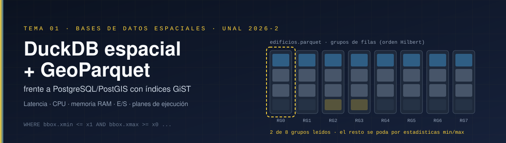
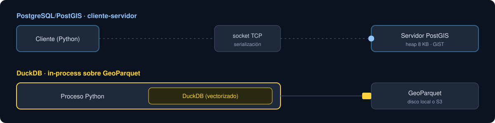

<div align="center">



<p>
  
  
  
  
  
</p>
<p>
  
  
  
</p>

**Proyecto final · Bases de datos espaciales · Universidad Nacional de Colombia · 2026-2**<br>
Profesor: Alexys Rodríguez Avellaneda · Seminario de la semana 13 · Equipo 01

[Objetivo](#objetivo) ·
[Sesión](#la-sesión-de-105-minutos) ·
[Entregables](#entregables) ·
[Instalación](#instalación-en-linux-macos-y-windows) ·
[Ejecución](#ejecución-del-experimento) ·
[Rúbrica](#cumplimiento-de-la-guía-y-la-rúbrica) ·
[Antecedentes](#antecedentes)

</div>


## Equipo

| Integrante | Programa | Rol en la sesión |
| :-- | :-- | :-- |
| Jesús Enrique Flores Riera | Maestría en Geomática, UNAL | Director de sesión |

## Objetivo

Evaluar experimentalmente cuándo un motor analítico columnar embebido (**DuckDB** con su extensión `spatial`) que consulta archivos **GeoParquet** supera a un sistema gestor relacional orientado a filas (**PostgreSQL/PostGIS** con índices **GiST**) en consultas analíticas vectoriales, midiendo latencia, CPU, memoria RAM, E/S de disco y planes de ejecución.

<div align="center">

</div>

### Preguntas orientadoras

1. ¿En qué magnitud reducen el formato columnar y el empuje de predicados (*predicate pushdown*) los tiempos de filtrado espacial frente a un escaneo indexado en PostGIS?
2. ¿Cuál es el límite de volumen de geometrías complejas que DuckDB procesa en memoria antes de degradarse por paginación en disco?

### Hipótesis

| | Hipótesis | Experimento |
| :-- | :-- | :-- |
| **H1** | Para ventanas pequeñas (1 % del área) el índice GiST es competitivo o superior; al crecer la ventana y en agregaciones sin filtro espacial, DuckDB supera a PostGIS. | E1, E2 |
| **H2** | El filtro sobre la columna `bbox` reduce latencia y bytes leídos solo si el archivo está ordenado espacialmente (curva de Hilbert). | E1 ordenado frente a sin orden |
| **H3** | Reducir `memory_limit` por debajo del conjunto de trabajo aumenta la latencia del cruce espacial por desborde a disco, hasta producir errores de memoria. | E3 y barrido de 1, 5 y 10 millones |


## La sesión de 105 minutos

| Bloque | Duración | Contenido | Material |
| :-- | :-: | :-- | :-- |
| 1 · Presentación | 30 min | Historia, importancia, características, aplicaciones, cuándo usarlo, limitaciones y diseño experimental | [`01_slides_duckdb_geoparquet.qmd`](proyectos/tema_01_duckdb_geoparquet/01_slides_duckdb_geoparquet.qmd) |
| 2 · Taller en vivo | 60 min | La cohorte ejecuta el mismo filtro y el mismo cruce espacial en PostGIS y en DuckDB, lee GeoParquet desde la nube y compara planes de ejecución | [`01_taller_duckdb_geoparquet.qmd`](proyectos/tema_01_duckdb_geoparquet/01_taller_duckdb_geoparquet.qmd) |
| 3 · Debate | 15 min | Métricas observadas: CPU, RAM, E/S y planes de ejecución | [`01_informe_duckdb_geoparquet.qmd`](proyectos/tema_01_duckdb_geoparquet/01_informe_duckdb_geoparquet.qmd) |

## Entregables

Estructura exigida por la guía del curso (`proyectos/tema_XX_[nombre_tema]/`):

| Artefacto | Descripción |
| :-- | :-- |
| [`01_informe_duckdb_geoparquet.qmd`](proyectos/tema_01_duckdb_geoparquet/01_informe_duckdb_geoparquet.qmd) | Reporte científico; se compila como capítulo del libro del curso |
| [`01_slides_duckdb_geoparquet.qmd`](proyectos/tema_01_duckdb_geoparquet/01_slides_duckdb_geoparquet.qmd) | Diapositivas Quarto RevealJS del bloque 1 |
| [`presentacion/index.html`](proyectos/tema_01_duckdb_geoparquet/presentacion/index.html) | Presentación interactiva HTML5 autocontenida (28 diapositivas animadas; flechas, rueda o botones; tecla N para notas del expositor) |
| [`01_taller_duckdb_geoparquet.qmd`](proyectos/tema_01_duckdb_geoparquet/01_taller_duckdb_geoparquet.qmd) | Guía ejecutable paso a paso del bloque 2 |
| [`references.bib`](proyectos/tema_01_duckdb_geoparquet/references.bib) | Literatura técnica y científica citada |

### Código del experimento

| Archivo | Qué hace |
| :-- | :-- |
| [`docker-compose.yml`](docker-compose.yml) | Servicios `db-postgis` (PostGIS 17-3.5) y `lab` (Python 3.12 + DuckDB 1.5.6) con el mismo presupuesto de CPU y RAM |
| [`docker/lab/Dockerfile`](docker/lab/Dockerfile) · [`requirements.txt`](docker/lab/requirements.txt) | Imagen del laboratorio con dependencias fijadas y extensiones de DuckDB preinstaladas |
| [`sql/00_init_postgis.sql`](sql/00_init_postgis.sql) | Inicialización del esquema `t01` |
| [`scripts/comun.py`](scripts/comun.py) | Rutas, área de estudio y conexiones compartidas |
| [`scripts/01_preparar_datos.py`](scripts/01_preparar_datos.py) | Overture Maps desde S3 o datos sintéticos → GeoParquet ordenado por Hilbert, sin ordenar y grilla |
| [`scripts/02_cargar_postgis.py`](scripts/02_cargar_postgis.py) | Carga los mismos registros en PostGIS, crea GiST y audita conteos |
| [`scripts/03_benchmark.py`](scripts/03_benchmark.py) | Experimentos E0-E3 con latencia, CPU, RSS y E/S |
| [`scripts/04_graficas.py`](scripts/04_graficas.py) | Resumen, figuras y verificación de que ambos motores responden lo mismo |
| [`scripts/monitor_docker.sh`](scripts/monitor_docker.sh) · [`monitor_docker.ps1`](scripts/monitor_docker.ps1) | Muestreo de `docker stats` (Linux/macOS · Windows) |
| [`resultados/`](resultados/) | Salidas medidas; ninguna cifra se escribe a mano |


## Instalación en Linux, macOS y Windows

Todo el experimento corre dentro de contenedores, de modo que el sistema anfitrión solo necesita **Git**, **Docker** y, para compilar los documentos, **Quarto**. Los comandos se escriben en la terminal integrada de Visual Studio Code.

| Requisito | Linux | macOS | Windows |
| :-- | :-- | :-- | :-- |
| Git | Gestor de paquetes (`apt`, `dnf`) | `xcode-select --install` o Homebrew | [Git for Windows](https://git-scm.com/download/win) |
| Docker | Docker Engine + plugin Compose | [Docker Desktop](https://www.docker.com/products/docker-desktop/) | Docker Desktop con backend WSL 2 |
| Quarto ≥ 1.4 | [quarto.org](https://quarto.org/docs/get-started/) | [quarto.org](https://quarto.org/docs/get-started/) | [quarto.org](https://quarto.org/docs/get-started/) |
| Memoria asignada a Docker | Toda la del equipo | ≥ 8 GB en *Settings → Resources* | ≥ 8 GB en *Settings → Resources* (o `.wslconfig`) |

<details>
<summary><b>Linux</b></summary>

```bash
git clone https://github.com/jf-floresriera/Proyecto_Bases_de_datos_espaciales.git
cd Proyecto_Bases_de_datos_espaciales
cp .env.example .env
docker compose up -d --build
docker compose ps
```

Si `docker` exige `sudo`, agregar el usuario al grupo `docker` (`sudo usermod -aG docker $USER`) y abrir una sesión nueva.

</details>

<details>
<summary><b>macOS (Intel y Apple Silicon)</b></summary>

```bash
git clone https://github.com/jf-floresriera/Proyecto_Bases_de_datos_espaciales.git
cd Proyecto_Bases_de_datos_espaciales
cp .env.example .env
docker compose up -d --build
docker compose ps
```

* La imagen oficial `postgis/postgis` solo existe para `amd64`. En equipos con chip M1-M4, `docker-compose.yml` declara `platform: linux/amd64` y Docker Desktop la ejecuta emulada; conviene activar *Settings → General → Use Rosetta for x86_64/amd64 emulation*.
* Por la emulación, los tiempos de PostGIS en Apple Silicon **no son comparables** con los del benchmark del informe. Sirven para seguir el taller, no para reportar cifras.

</details>

<details>
<summary><b>Windows 10/11</b></summary>

En PowerShell:

```powershell
git clone https://github.com/jf-floresriera/Proyecto_Bases_de_datos_espaciales.git
cd Proyecto_Bases_de_datos_espaciales
Copy-Item .env.example .env
docker compose up -d --build
docker compose ps
```

* Docker Desktop debe usar el backend WSL 2.
* El repositorio incluye [`.gitattributes`](.gitattributes) para que los scripts conserven finales de línea LF; si se clonó antes de que existiera, lo más seguro es volver a clonarlo.
* El monitor de recursos tiene versión PowerShell: `powershell -ExecutionPolicy Bypass -File scripts/monitor_docker.ps1 resultados/docker_stats.csv`.

</details>

Antes de levantar los contenedores, cambiar `PGPASSWORD` en `.env`. El puerto de PostGIS en el sistema anfitrión es `5433` (variable `PGPORT_HOST`) para no chocar con un PostgreSQL local:

```bash
psql -h localhost -p 5433 -U bde -d bde_t01
```

## Ejecución del experimento

Los mismos comandos funcionan en los tres sistemas, porque se ejecutan dentro del contenedor `lab`:

```bash
docker compose exec lab python scripts/01_preparar_datos.py                 # Overture Maps (Bogotá)
docker compose exec lab python scripts/02_cargar_postgis.py
docker compose exec lab python scripts/03_benchmark.py --reps 5
docker compose exec lab python scripts/04_graficas.py
```

Sin conexión, o para el barrido de volumen de la pregunta 2:

```bash
docker compose exec lab python scripts/01_preparar_datos.py --fuente sintetico --n 5000000
```

Compilación de los documentos Quarto:

```bash
quarto render proyectos/tema_01_duckdb_geoparquet/01_slides_duckdb_geoparquet.qmd
quarto render proyectos/tema_01_duckdb_geoparquet/01_taller_duckdb_geoparquet.qmd
quarto render proyectos/tema_01_duckdb_geoparquet/01_informe_duckdb_geoparquet.qmd
```


## Cumplimiento de la guía y la rúbrica

| Criterio (peso) | Cómo lo atiende el proyecto |
| :-- | :-- |
| Rigor teórico (20 %) | Marco teórico del informe: almacenamiento columnar, ejecución vectorizada, GeoParquet 1.1 y `bbox`, GiST/R-tree y fracción de grupos de filas podados, con citas en [`references.bib`](proyectos/tema_01_duckdb_geoparquet/references.bib) |
| Implementación y taller (25 %) | Scripts modulares, entorno Docker idéntico para la cohorte y guía del taller cronometrada a 60 minutos |
| Perfilamiento de rendimiento (25 %) | Latencia, CPU, RSS, lecturas de E/S, `EXPLAIN (ANALYZE, BUFFERS)` y `docker stats`; mediana e IQR de cinco repeticiones; auditoría de que ambos motores devuelven el mismo resultado |
| Reproducibilidad (15 %) | Historial de commits progresivo, dependencias fijadas, datos abiertos (Overture Maps) y modo sintético con semilla fija |
| Estándares Quarto (15 %) | Opciones `#\|` y `--\|`, etiquetas `kebab-case` con prefijos `setup-`, `docker-`, `ddl-`, `dml-`, `query-`, `audit-`, `export-`; referencias `@tbl-`, `@fig-`, `@eq-` y citas BibTeX |

### Estado

- [x] Entorno Docker, scripts y documentos Quarto redactados
- [x] Compatibilidad documentada para Linux, macOS y Windows
- [ ] Ejecución del benchmark en el equipo de referencia
- [ ] Barrido de volumen (1, 5 y 10 millones de registros)
- [ ] Tablas, figuras, discusión y conclusiones del informe con los valores medidos
- [ ] Ensayo cronometrado del taller desde un clon limpio

## Datos abiertos

* [Overture Maps Foundation](https://docs.overturemaps.org/getting-data/duckdb), tema `buildings`, consultado directamente en `s3://overturemaps-us-west-2/`. La versión usada queda registrada en la salida de `01_preparar_datos.py`.
* Modo sintético con semilla fija para reproducir el barrido de volumen sin red.

## Antecedentes

El patrón PostGIS (transaccional) + DuckDB (analítico) con exportación a GeoParquet se implementó primero en la tesis de maestría del autor, en los commits `c45ae22` y `a0dcd30` del **7 de octubre de 2026**. La copia de `analytics.py` es idéntica byte a byte al original (misma huella SHA-1). Detalle, enlaces y comandos de verificación en [`antecedentes/README.md`](antecedentes/README.md).

<div align="center">

<sub>Universidad Nacional de Colombia · Bases de datos espaciales · 2026-2</sub>
</div>
